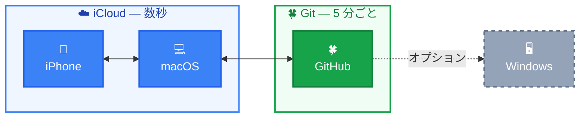
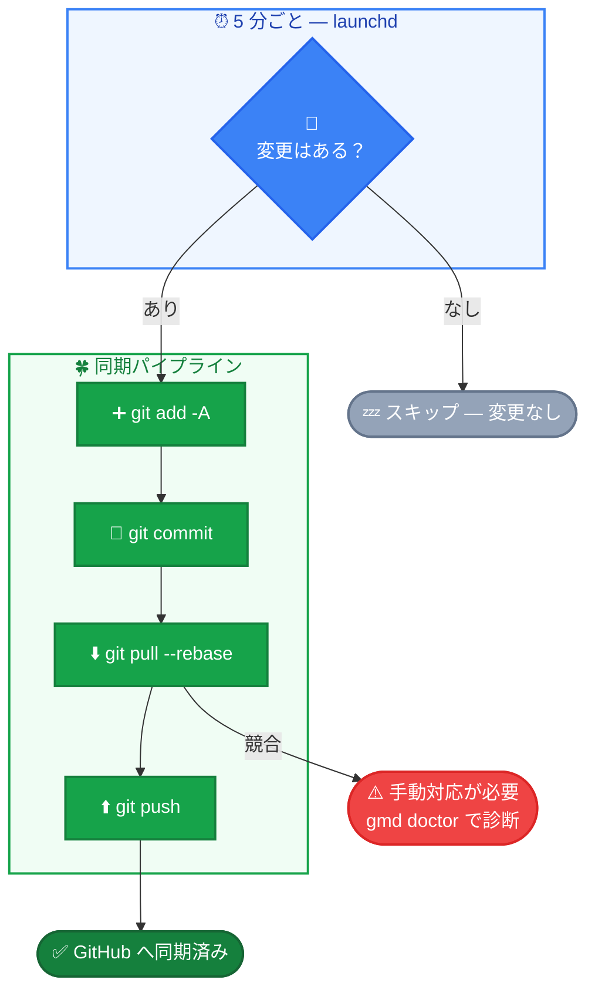

# zeromd


[中文](README.zh.md) | [English](README.md) | **日本語**

ローカルファーストの Obsidian マルチデバイス同期。費用ゼロ。登録ゼロ。メンテナンスゼロ。

## なぜ作ったのか

最も AI ネイティブなナレッジベースは、API を備えた SaaS 製品ではありません。ディスク上にある markdown ファイルのフォルダです。

そして `.md` の進化はまだ終わっていません。Mermaid はすでにプレーンテキストを動的な図へ変えています。次はインタラクティブ性が加わるかもしれません。

Obsidian はすべてのノートをプレーンな `.md` ファイルとして保存します。Claude Code のような AI ツールは、**ナレッジベースを直接読み書き**できます。

`API 不要` &ensp; `プラグイン不要` &ensp; `ミドルウェア不要`

```bash
# Claude Code は vault をそのまま扱える
Grep "システム設計" ~/vault/       # すべてのノートを検索
Read ~/vault/some-note.md           # 内容を読む
Edit ~/vault/some-note.md           # 内容を変更する
Glob "**/*.md" ~/vault/             # ナレッジベース全体を走査
```

クラウドベースのソリューションと比較すると：

|  | Obsidian vault | Notion |
|--|---------------|--------|
| AI アクセス | ファイルを直接読み書き、設定不要 | API + OAuth + MCP が必要 |
| データ形式 | 標準 markdown | 独自ブロック形式、パースが必要 |
| 読み書き速度 | ローカル I/O、ミリ秒単位 | ネットワークリクエスト + レート制限 |
| 変更履歴 | すべての変更を Git log で完全に記録 | なし |
| データ所有権 | 自分のディスク上のファイル | 他社のサーバー上に保存 |

**ローカルファイル + 標準形式 = 「連携」すら不要。そのまま動きます。**

zeromd は、このローカルなナレッジベースをすべてのデバイス間で同期し続けます。

## アーキテクチャ



- **macOS ↔ iOS**：iCloud が自動同期（数秒）
- **macOS ↔ GitHub**：Git による定期同期（5 分ごと、変更がある場合のみ）

Windows ユーザーはリポジトリを `git clone` し、[obsidian-git](https://github.com/denolehov/obsidian-git) で同期できます。

## クイックスタート

**前提条件**：Mac の Obsidian に iCloud vault があること。

```bash
bash <(curl -sL https://raw.githubusercontent.com/yuukiLike/zeromd/main/install-remote.sh)
```

インストーラーは vault を検出して Git をセットアップし、`SSH` または `HTTPS` を選択できるようにします。その後、GitHub へ接続して同期を開始します。

- **vault が 1 つ + `gh` CLI** → リポジトリを作成または接続し、選択したプロトコルを使用
- **手動セットアップ** → `SSH` または `HTTPS` を選び、その形式に合う repo URL を貼り付け
- **SSH キーなし** → HTTPS はそのまま使用可能。SSH のセットアップでは解決方法を具体的に案内

**iPhone**：Obsidian をインストール → 同じ iCloud vault を開く。これだけです。

## `md` ではなく `gmd` を使う理由

一部の shell 環境は `md` をエイリアスとして定義しています（例：oh-my-zsh の `md='mkdir -p'`）。競合を避けるため、メインコマンドは `gmd`（git + md）です。使用中の shell で `md` が使われていなければ、`md` も使えます。どちらも同じスクリプトを指します。

## 動作確認

**Mac → iPhone**：Mac でノートを作成し、30 秒以内に iPhone に表示されることを確認します。

**iPhone → Mac**：iPhone で何か書き、30 秒以内に Mac に表示されることを確認します。

**Git 同期**：5 分待つか `gmd sync` を実行し、GitHub に新しいコミットがあることを確認します。現在の状態は `gmd status` で確認できます。

**SSH と HTTPS のどちら？** zeromd は両方に対応しています。HTTPS を使って GitHub に認証を拒否された場合、zeromd は単なる push 失敗ではなく、HTTPS 認証エラーとして通知します。

**新しい Mac へ移行した場合？** その Mac で最初に同期する際、zeromd はローカル vault が `origin/main` と同期済みかを確認します。競合の可能性がある場合は、先にローカルの `zeromd-backup-<timestamp>` ブランチを作成し、その後でローカルの `main` を `origin/main` へ強制リセットします。

## 同期の仕組み

**iCloud**（macOS ↔ iOS）：Apple が自動的に処理します。vault は `~/Library/Mobile Documents/iCloud~md~obsidian/Documents/<vault>/` に保存され、数秒で同期されます。

**Git**（macOS ↔ GitHub）：launchd ジョブが 5 分ごとに `sync.sh` を実行します。



**5 分の理由**：30 秒では頻繁すぎ、1 時間では遅すぎます。考えをひと区切り書き終えるのに 5 分がちょうどよいのです。`~/Library/LaunchAgents/com.zeromd.sync.plist` の `StartInterval` で調整できます。

## 他の方法を選ばない理由

| 代替案 | 選ばない理由 |
|--------|------------------|
| iCloud のみ | Windows との同期が弱く、変更履歴がない |
| Obsidian Sync | 月額約 $4、10 年で約 $480 |
| Git のみ | iOS に優れた無料 Git クライアントがない |
| Notion | 独自形式、データがローカルになく、AI アクセスに API が必要 |
| セルフホスト | メンテナンスコストが高く、保守をやめると止まる |

この方法では、Apple エコシステム内の同期に iCloud、クロスプラットフォームと変更履歴に Git を使います。費用はゼロです。

## リスクと対策

| リスク | 対策 |
|--------|------|
| iCloud が .git を破損する | 可能性は低い。リモートリポジトリが完全なバックアップになる |
| Mac がオフの間は iOS の編集を push できない | Mac の起動後に自動同期 |
| Git の競合 | `pull --rebase` + プレーンテキストなので解決しやすい |
| GitHub の障害 | ローカル + iCloud の二重バックアップ |

## よく使うコマンド

```bash
gmd                      # 同期状態を確認（gmd status と同じ）
gmd doctor               # ヘルスチェックと問題の診断
gmd sync                 # 今すぐ手動同期
gmd log                  # 最新 20 件のログを表示
gmd log 50               # 最新 50 件のログを表示
gmd setup                # スマートセットアップ（冪等、完了済みの手順はスキップ）
gmd help                 # コンパクトなヘルプ（中国語・英語・日本語に対応）
# md も gmd の後方互換エイリアスとして使用可能
```

言語を指定しない場合、`gmd help` と `gmd doctor` は macOS の優先言語を使います。コマンド引数で指定した言語が最優先されます。中国語は `zh`（便宜上のエイリアスとして `cn` も対応）、英語は `en`、日本語は `ja` を使います。例：`gmd help ja`、`gmd doctor cn`。言語設定を固定するには、シェル設定に `export ZEROMD_LANG=ja`（または `zh`、`cn`、`en`）を追加します。

**vault の名前を変えた場合？** 何もする必要はありません。sync.sh が iCloud の Obsidian ディレクトリから `.git` のある vault を自動検出します。

**同期に問題がある場合？** `gmd doctor` を実行して診断します。

**バックグラウンドタスクが止まった場合？** `gmd setup` を再実行します。 **vault を切り替える場合？** `gmd init` を実行します。

**HTTPS 認証に失敗した場合？** GitHub は Git 操作でアカウントパスワードを受け付けません。システムの Git が使用する HTTPS 認証情報を更新するか、リポジトリを SSH に切り替えてください。

**新しい Mac に古いローカルコミットが表示される場合？** 最初の同期で `origin/main` と比較します。ローカルの状態が古い、または分岐している場合、zeromd は先に `zeromd-backup-<timestamp>` ブランチへ保存し、ローカルの `main` を `origin/main` に合わせ直します。

## アンインストール

```bash
bash scripts/uninstall.sh
```

ノートには影響ありません。iCloud 同期は継続し、GitHub への自動プッシュだけが停止します。

## コントリビューション

```bash
bash tests/run.sh
```

依存関係のない Pure Bash のテストスイートです。`scripts/` 内を変更したときは実行し、PR を提出する前にすべてのテストが通ることを確認してください。

## プロジェクト構成

```
zeromd/
├── scripts/
│   ├── zeromd               # CLI クライアント（gmd status/sync/doctor/log/setup/help）
│   ├── setup.sh            # スマートインストーラー（冪等、8 フェーズ）
│   ├── install.sh          # 後方互換ラッパー → setup.sh
│   ├── uninstall.sh        # アンインストール
│   └── sync.sh             # 自動同期（5 分ごと）
├── tests/
│   ├── run.sh              # テストランナー
│   ├── test_zeromd.sh       # CLI テスト
│   ├── test_sync.sh        # 同期ロジックのテスト
│   └── test_setup.sh       # セットアップロジックのテスト
├── install-remote.sh       # curl による 1 行インストールのエントリーポイント
├── com.zeromd.sync.plist    # launchd ジョブのテンプレート
├── LICENSE
├── README.md               # English
├── README.zh.md            # 中文
└── README.ja.md            # 日本語
```
